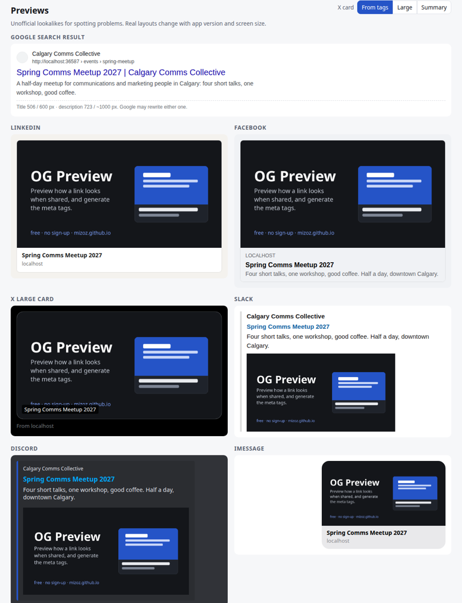

# OG Preview

**Live: https://lab.zalastack.com/og-preview/**

Check how a link looks when it's shared, and generate the meta tags to fix it.



I built this because every launch I've worked on had the same moment: someone shares the link, the preview shows the wrong image (or a cookie banner logo, or nothing), and then we find out LinkedIn cached it. The existing checkers either want a sign-up, fetch your page through their server, or only show one platform. I wanted all of them on one page, with the actual fix next to each problem.

## What it does

- **Check a page.** Paste the HTML (or just the `<head>`), try fetching the URL, or use the bookmarklet on the page you're looking at. It parses the title, description, canonical, Open Graph, X card tags, favicon and JSON-LD.
- **Previews** for a Google result (title and description cut by measured pixel width, not character count), LinkedIn, Facebook, X large and summary cards, Slack, Discord, iMessage and WhatsApp. These are lookalikes, not official renderings.
- **Checks with fixes:** missing og:image, image too small or wrong ratio (loads the image and measures it), relative or http image URLs, long titles and descriptions, missing twitter:card or canonical, duplicate tags, `name=` vs `property=`, broken JSON-LD, noindex.
- **Generate tags.** Fill in the fields, watch the previews update, copy a clean `<head>` snippet. "Fix in generator" pre-fills it from a page you checked. You can test a local image before uploading it.
- Share the generator state with a link, and it remembers your last inputs.

## About fetching URLs

A static page can't read another site's HTML unless that site allows it (CORS). Most don't, so "Try to fetch" usually fails, and the page explains why and what to do. I didn't want to run a proxy that sees everyone's URLs, so the workarounds are paste or bookmarklet. The bookmarklet puts the tags in the URL hash, which never gets sent to a server.

## Privacy

No accounts, no analytics, no cookies. Your HTML is parsed in your browser. The only requests the page makes are the ones you trigger: fetching the URL you typed, and loading the og:image so it can be measured. Last inputs are kept in localStorage on your device.

## Run it locally

Plain HTML, CSS and JS. No build step.

```
python3 -m http.server
```

Then open http://localhost:8000.

## Sources

Last checked 2026-10-21.

- Facebook, images in link shares: https://developers.facebook.com/docs/sharing/webmasters/images/ (1200 x 630 recommended, 200 x 200 minimum, 8 MB max, 1.91:1)
- LinkedIn, how to make sure the right image shows: https://www.linkedin.com/help/linkedin/answer/a521928 (1200 x 627 minimum, 1.91:1, 5 MB max, under 401 px wide shows as a thumbnail)
- X, summary card with large image: https://developer.x.com/en/docs/x-for-websites/cards/overview/summary-card-with-large-image (2:1, 300 x 157 min, 4096 x 4096 max, under 5 MB)
- X, cards markup: https://developer.x.com/en/docs/x-for-websites/cards/overview/markup
- Slack, unfurling links: https://docs.slack.dev/messaging/unfurling-links-in-messages/ (reads Open Graph and X card tags; no image size published)
- Apple, TN3156 Create rich previews for Messages: https://developer.apple.com/documentation/technotes/tn3156-create-rich-previews-for-messages
- The Open Graph protocol: https://ogp.me/

Discord and WhatsApp don't publish image sizes, so the page says "recommended" for those. The Google title (about 600 px) and description (about two lines) cutoffs are observed behaviour, not official numbers.

## License

MIT. See [LICENSE](LICENSE).
